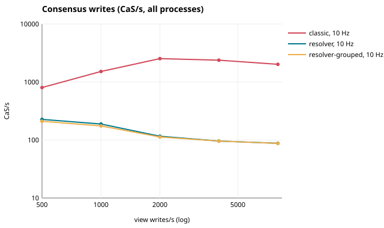
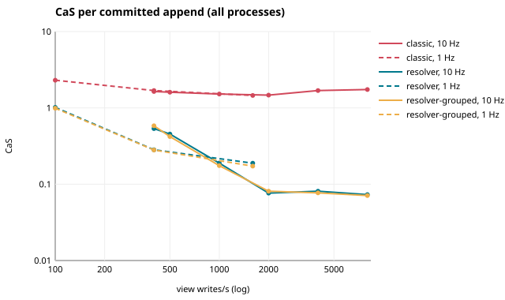
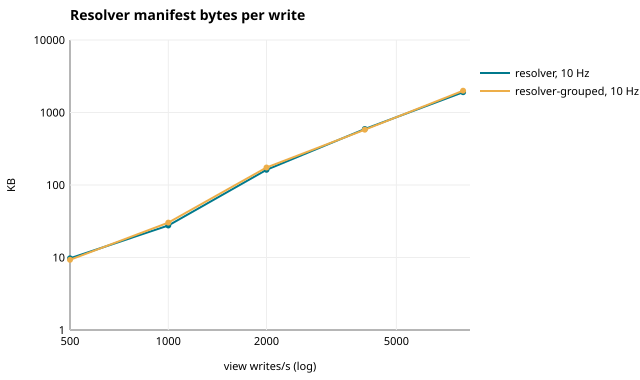
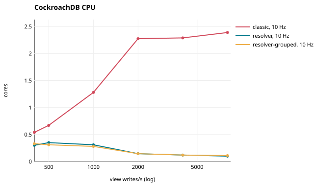
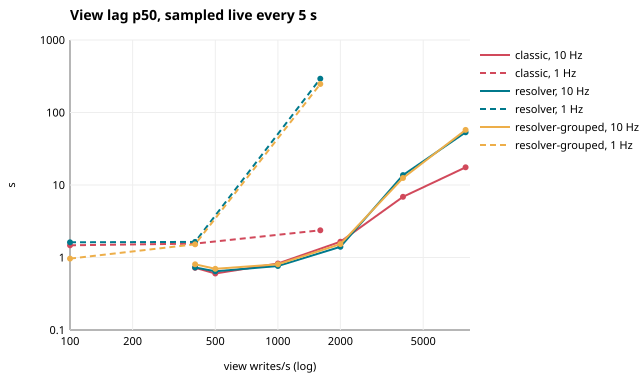
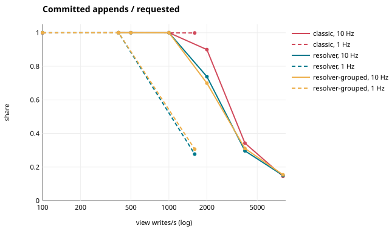
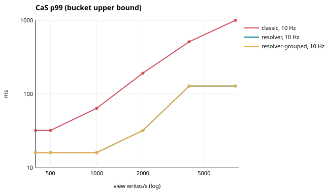

# Persist resolver A/B: classic vs resolver vs resolver with upper groups

PROTOTYPE results. Three arms on one box, run one at a time, the same binaries for every arm:

- **classic**: every user shard is a persist shard and does its own consensus CaS.
- **resolver**: user shards are data shards served by one resolver, `--upper-groups=false`.
- **resolver-grouped**: the same with `--upper-groups=true`, so data shards whose uppers move together
  share one `Group` row.

The workload is the cloud MV freshness report's: a COUNTER load generator ticks into `ticks`, and every
view turns each tick into 10 rows, so view writes/s = views x tick rate. Every number below traces to a
`results/<run>/summary.json` (per-run tables in [results.md](results.md), generated by `report.py`) or to
[diagnostics/](diagnostics/README.md).

## Verdict

1. **Consensus load: the resolver arms win by a wide margin.** Per committed append, classic makes
   1.4-1.7 CaS (2.3 at the lightest point). The resolver arms make 0.42-0.58 at 400-500 view writes/s
   and 0.07-0.09 at 2,000 view writes/s and above on the 100 ms tick, and their CaS/s stays at 83-233
   whatever the load, most of it from the builtin, catalog and txn-wal shards that stay classic in every
   arm. CRDB CPU: 0.10-0.35 cores against classic's 0.21-2.4 (of 4).
2. **Freshness: the resolver arms do not win, and lose past the knee.** All three keep up to 1,000 view
   writes/s and are near 100% fresh at 2,000. At 4,000 view writes/s classic is 56% fresh, the resolver
   arms 20-25%. At 8,000 all three are under 3%. At a 1 s tick with 1,600 views classic commits every
   append while both resolver arms commit under a third and fall minutes behind.
3. **Upper groups: no measurable difference in this workload.** At every point grouped and ungrouped are
   within each other's run-to-run range on CaS/s, manifest bytes per write, committed appends and
   freshness. Every view appends data every tick here, and an append moves a shard out of its group, so
   the `Batch` rows with their inline data, not the `Upper` rows, make up the manifest writes. In a
   sparse variant (0.1 rows per tick, so 9 of 10 ticks only advance the upper) groups cut manifest rows
   per commit from 2.2 to 1.6 but not throughput (below).
4. **The limiters differ, and none is persist's CaS count.** Classic is bound by the box's disk write
   IOPS under CRDB. The resolver is bound by its single cycle task: at 10 Hz by large manifest writes
   (0.6-2 MB, written to blob) and the copying around them, at 1 Hz x 1,600 views by CPU spent building
   and encoding shard views for fetches, watches and acks.

## Headline: sweeps 2 and 3

Binaries from `590fd1f63b` (hashes in `results/BINARIES-sweep2.txt`), 10 rows per tick, one 600 s window
per run. Median, with the range when a point ran more than once. "Fresh" is the share of
`mz_wallclock_global_lag_histogram` samples in bucket 1, which is lag under 2 s
(`lag.as_secs().next_power_of_two()`). The cloud report calls it "<= 1 s". Live lag p50 is from
`mz_internal.mz_frontiers` sampled every 5 s.

<!-- headline:start -->
| tick | views | view writes/s | arm | runs | committed / requested appends | fresh (<2 s) | live lag p50 s | CaS/s | CaS per committed append | CRDB cores | manifest KB/write |
|---|---|---|---|---|---|---|---|---|---|---|---|
| 100 ms | 40 | 400 | classic | 1 | 400 / 400 | 1.000 | 0.72 | 656 | 1.641 | 0.54 | - |
| 100 ms | 40 | 400 | resolver | 1 | 400 / 400 | 1.000 | 0.73 | 214 | 0.535 | 0.30 | 8 |
| 100 ms | 40 | 400 | resolver-grouped | 1 | 400 / 400 | 1.000 | 0.81 | 233 | 0.583 | 0.33 | 7 |
| 100 ms | 50 | 500 | classic | 1 | 500 / 500 | 1.000 | 0.60 | 802 | 1.605 | 0.67 | - |
| 100 ms | 50 | 500 | resolver | 1 | 500 / 500 | 1.000 | 0.65 | 227 | 0.454 | 0.35 | 10 |
| 100 ms | 50 | 500 | resolver-grouped | 1 | 500 / 500 | 1.000 | 0.70 | 210 | 0.421 | 0.31 | 9 |
| 100 ms | 100 | 1,000 | classic | 1 | 1,000 / 1,000 | 1.000 | 0.83 | 1,521 | 1.521 | 1.28 | - |
| 100 ms | 100 | 1,000 | resolver | 1 | 1,000 / 1,000 | 1.000 | 0.76 | 189 | 0.189 | 0.31 | 28 |
| 100 ms | 100 | 1,000 | resolver-grouped | 1 | 1,000 / 1,000 | 1.000 | 0.81 | 175 | 0.175 | 0.28 | 30 |
| 100 ms | 200 | 2,000 | classic | 2 | 1,799 (1,600-1,998) / 2,000 | 0.997 (0.994-1.000) | 1.65 (0.83-2.47) | 2,622 (2,531-2,712) | 1.470 (1.357-1.582) | 2.27 (2.26-2.29) | - |
| 100 ms | 200 | 2,000 | resolver | 2 | 1,477 (1,443-1,512) / 2,000 | 0.999 (0.999-1.000) | 1.40 (1.24-1.57) | 113 (110-116) | 0.076 (0.076-0.077) | 0.15 (0.14-0.15) | 190 (162-218) |
| 100 ms | 200 | 2,000 | resolver-grouped | 2 | 1,398 (1,394-1,403) / 2,000 | 1.000 (1.000-1.000) | 1.53 (1.52-1.54) | 113 (113-114) | 0.081 (0.080-0.082) | 0.15 (0.14-0.15) | 172 (170-174) |
| 100 ms | 400 | 4,000 | classic | 2 | 1,369 (1,289-1,448) / 4,000 | 0.558 (0.521-0.596) | 6.88 (6.34-7.43) | 2,307 (2,234-2,379) | 1.688 (1.642-1.733) | 2.23 (2.16-2.29) | - |
| 100 ms | 400 | 4,000 | resolver | 2 | 1,183 (1,127-1,239) / 4,000 | 0.198 (0.175-0.221) | 13.68 (12.95-14.41) | 96 (96-96) | 0.081 (0.077-0.085) | 0.12 (0.12-0.12) | 604 (593-615) |
| 100 ms | 400 | 4,000 | resolver-grouped | 2 | 1,242 (1,224-1,260) / 4,000 | 0.252 (0.235-0.269) | 12.50 (12.47-12.53) | 96 (96-96) | 0.077 (0.076-0.078) | 0.12 (0.12-0.12) | 568 (556-580) |
| 100 ms | 800 | 8,000 | classic | 1 | 1,159 / 8,000 | 0.023 | 17.57 | 2,018 | 1.741 | 2.39 | - |
| 100 ms | 800 | 8,000 | resolver | 1 | 1,201 / 8,000 | 0.001 | 53.30 | 88 | 0.073 | 0.10 | 1,905 |
| 100 ms | 800 | 8,000 | resolver-grouped | 1 | 1,232 / 8,000 | 0.001 | 57.59 | 87 | 0.071 | 0.11 | 1,996 |
| 1000 ms | 100 | 100 | classic | 1 | 100 / 100 | n/a (1 s tick) | 1.47 | 230 | 2.304 | 0.21 | - |
| 1000 ms | 100 | 100 | resolver | 1 | 100 / 100 | n/a (1 s tick) | 1.62 | 102 | 1.016 | 0.12 | 17 |
| 1000 ms | 100 | 100 | resolver-grouped | 1 | 100 / 100 | n/a (1 s tick) | 0.97 | 99 | 0.989 | 0.11 | 18 |
| 1000 ms | 400 | 400 | classic | 1 | 400 / 400 | n/a (1 s tick) | 1.56 | 676 | 1.689 | 0.58 | - |
| 1000 ms | 400 | 400 | resolver | 1 | 400 / 400 | n/a (1 s tick) | 1.64 | 113 | 0.283 | 0.13 | 42 |
| 1000 ms | 400 | 400 | resolver-grouped | 1 | 400 / 400 | n/a (1 s tick) | 1.52 | 112 | 0.281 | 0.13 | 42 |
| 1000 ms | 1600 | 1,600 | classic | 2 | 1,598 (1,596-1,600) / 1,600 | n/a (1 s tick) | 2.37 (1.95-2.80) | 2,324 (2,275-2,372) | 1.454 (1.422-1.487) | 2.17 (2.14-2.21) | - |
| 1000 ms | 1600 | 1,600 | resolver | 2 | 443 (443-444) / 1,600 | n/a (1 s tick) | 292.56 (280.37-304.75) | 84 (83-84) | 0.189 (0.188-0.189) | 0.10 (0.10-0.10) | 1,320 (1,303-1,337) |
| 1000 ms | 1600 | 1,600 | resolver-grouped | 2 | 490 (476-505) / 1,600 | n/a (1 s tick) | 247.09 (148.48-345.70) | 85 (84-85) | 0.172 (0.166-0.179) | 0.10 (0.10-0.10) | 1,232 (540-1,925) |
<!-- headline:end -->

Charts, one line per arm and tick rate (solid 100 ms, dashed 1 s), x is view writes/s:

| | |
|---|---|
|  |  |
|  |  |
|  |  |
|  |  |

### Reading the columns

- **Committed appends/s** is the view clusters' successful `compare_and_append` commands per second.
  Those clusterds are the only writers of the views' shards. The command count also includes any that
  returned an upper mismatch, so it is an upper bound, and in classic the view clusterds' CaS/s exceeds
  it as it must (2,411 vs 1,600 at 200 views). Requested is views x ticks/s.
- **CaS per committed append** divides every process's CaS (environmentd, every clusterd, the resolver)
  by committed appends: consensus writes per unit of real work.
- **At a 1 s tick the histogram cannot measure freshness.** The controller samples each collection's lag
  once a second, in fixed phase with the tick, so every sample of a run lands in the same bucket either
  side of the 2 s edge: classic at 400 views was `{'1': 240000}` in sweep 1 and `{'2': 240000}` in sweep
  2, with live lag p50 1.52 and 1.56 s. Use live lag there.

## Upper groups in a sparse workload

400 views at 100 ms, 0.1 rows per view per tick (the spec sheet's `persist_mvs` staggered formula), one
run per arm:

| arm | committed / requested appends | live lag p50 s | CaS/s | CaS per append | CRDB cores | cycles/s | commit p50 ms | manifest KB/write | resolver cores |
|---|---|---|---|---|---|---|---|---|---|
| classic | 3,977 / 4,000 | 0.72 | 4,246 | 1.07 | 2.99 | - | - | - | - |
| resolver | 3,934 / 4,000 | 1.08 | 167 | 0.043 | 0.26 | 64.5 | 66 | 10.3 | 2.44 |
| resolver-grouped | 3,709 / 4,000 | 1.35 | 144 | 0.039 | 0.22 | 47.1 | 131 | 10.6 | 2.70 |

From the resolver's counters (`snapshot-*.json.gz`): ungrouped writes 137 rows per manifest write over
62 commits (2.2 rows per commit, the `-Upper`/`+Upper` pair). Grouped writes 126 rows over 80 commits
(1.6 per commit) at 86 vs 77 bytes per row, about 21% fewer bytes per commit. That is far from the ideal
of one `Group` row per cycle. The likely reason is that the 400 views' appends for one tick reach the
resolver across several cycles (47-64 cycles/s against 10 ticks/s), so within one cycle only part of a
group advances, the group diverges and regrouping moves members out and back. Not verified at the row
level. Grouping also costs the cycle CPU (2.70 vs 2.44 cores) and latency (commit p50 131 vs 66 ms).
In the dense workload, rows per manifest write were 697 grouped vs 827 ungrouped at 400 views, but each
row there averages 734-852 bytes (inline batch data), so bytes per write barely move.

## Limiters (benchmark checklist)

All from unreported diagnostic runs, [diagnostics/README.md](diagnostics/README.md).

- **Classic: disk write IOPS under CRDB.** At 400 views x 10 Hz classic commits ~1,300 of 4,000 appends/s.
  8 view clusters instead of 4 (twice the timely workers): 1,334. CRDB on 8 cores instead of 4: 1,242,
  CRDB still at ~2.2 cores. Persist's consensus pool at 200 instead of 50: 1,383, with CRDB statement p50
  up from 73 to 117 ms and fresh share down. During the 800-view run the volume did ~3,100 writes/s,
  ~80 MB/s at 88-90% utilization (an EBS volume, whose gp3 baseline is 3,000 IOPS), and CRDB's own mean
  raft log-commit latency was ~56 ms. Classic's plateau tracks consensus bytes (5-6.5 MB/s of CaS
  payload at 2.0-3.3 KB per CaS) more than CaS count: the sparse variant ran 4,246 CaS/s at 2.7 MB/s and
  kept up.
- **Resolver at 10 Hz: the cycle, behind large manifest writes.** At 800 views a cycle carries ~550
  commits and ~2 MB of rows, so every write spills past the 64 KiB inline limit to blob. Manifest write
  p50 is 131-262 ms (power-of-two bucket bounds) of a ~310-370 ms cycle (2.7-3.2 cycles/s). The resolver process itself wrote ~30 MB/s to disk (blob parts,
  rollups, manifest compaction), the volume was at ~3,200 writes/s, and the profile is ~30% kernel and
  ~31% libc copies, with cloning of `ProtoHollowBatchPart` vectors (views carrying inline batch data)
  among the Rust frames.
- **Resolver at 1 Hz x 1,600 views: the cycle's CPU.** Manifest write p50 is 4 ms and the disk is at 25%,
  yet the resolver manages 1.2-2.8 cycles/s. One tokio worker runs at ~91% while the resolver serves
  ~2,000 fetches/s and ~1,200 watches/s, each answered with a full shard view from the single cycle task.
  The profile: ~41% libc copy and alloc, ~21% kernel, ~10% `BTreeMap` building of `String ->
  ProtoIntent` maps, ~7% `prost` encoding.
- **Did it happen (Q7).** Every run checked its mode: resolver arms leave every user shard with no
  consensus row of its own, classic leaves every one with rows (`mode.ok`). Ticks ran within 2% of the
  configured rate and a view wrote 9.8-10.2 rows per tick (`ticks_per_s`, `mv0_rows_per_s`), and lag
  samples equal views x window seconds in every run.
- **Errors (Q4).** No process exited early and no panic in any reported run. The one panic class seen,
  in the first 800-view probe, was a prototype bug in applying compaction results to synthesized state,
  fixed in `bb28a841bb` before any reported run (probe kept as `results/prefix-resolver-v800-t100-probe`).
- **Reproducibility (Q5).** 1-3 runs per point, not the 5 the checklist asks for. Classic vs resolver
  CaS/s and CRDB CPU differ by 3-25x, far outside any spread seen. Grouped vs ungrouped differences are
  inside the spread at every repeated point, so no difference is claimed. The knee is noisy: classic at
  200 views committed 1,600 and 1,998 appends/s in two runs.

## How one box differs from the cloud report

| | cloud report (v26.41) | here |
|---|---|---|
| metadata store | RDS Postgres, 16 vCPU, write IOPS to ~16k | CockroachDB v23.1.11 single node in Docker, pinned to 4 cores, 16 GiB, on an EBS volume at ~3k write IOPS |
| blob | S3 (a 2 MB PUT costs tens of ms) | `file://` on the same EBS volume as CRDB |
| compute | 20 clusters x 100cc | 4 view clusters x 4 workers, 1 ingest cluster, on 44 cores shared with environmentd and the resolver |
| network | cross-AZ RTTs | loopback |
| knee (view writes/s) | ~8,000 | ~2,000 (classic and resolver) |
| dead tuples | Postgres dead rows to ~2.5M | CRDB MVCC garbage in the consensus table at the end of a classic run: 0.2-9.4 GB |

So the absolute knee is about 4x lower here, set by a slower disk. The consensus-load ratios (CaS per
append, CRDB CPU) don't depend on the disk. The resolver's freshness here is likely optimistic about blob
(local file writes instead of S3 PUTs) and pessimistic about disk (blob competes with CRDB for the same
IOPS).

## Sweep 1 and cut corners

- Sweep 1 (classic and ungrouped resolver, before upper groups existed) is tabled in
  [results.md](results.md) and agrees with sweep 2 within the spreads above. Its configs record a
  `git_head` that moved during the sweep, but its binaries did not (`sweep_note` in each config).
- The resolver arms' CaS/s includes the classic builtin, catalog and txn-wal shards, ~85-110/s.
  Subtracting it would make the resolver's per-append ratio lower still.
- Prototype cuts that shape these numbers: no pipelining (one manifest write in flight), long-poll
  wakeups per open shard, every fetch and ack returns a full shard view, inline data stays in `Batch`
  rows. See `2026-11-13_resolver-prototype-impl.md` in the sandbox.

## Reproduce

```
cargo build --release --bin environmentd --bin clusterd --bin persist-resolver
test/persist-resolver/bench/sweep.sh 100 40 50 100 200 400 800 -- --duration 600 --hydration-timeout 300
test/persist-resolver/bench/sweep.sh 1000 100 400 1600 -- --duration 600 --hydration-timeout 300
test/persist-resolver/bench/report.py
```

Needs Docker with `cockroachdb/cockroach:v23.1.11`, `psql`, and `taskset`. One run takes 13-40 minutes.
